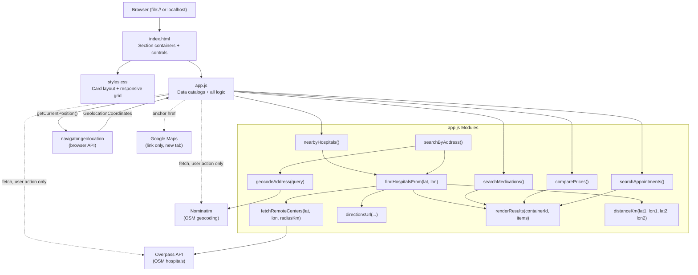
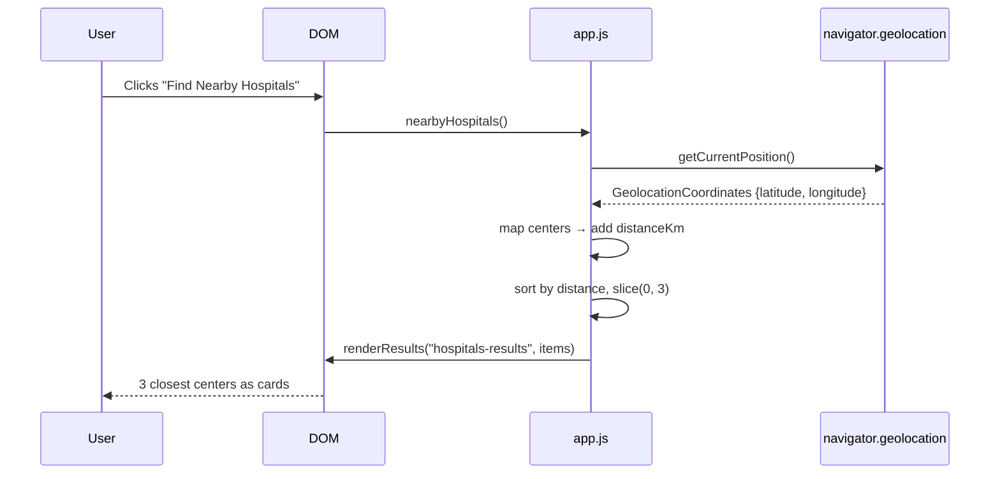
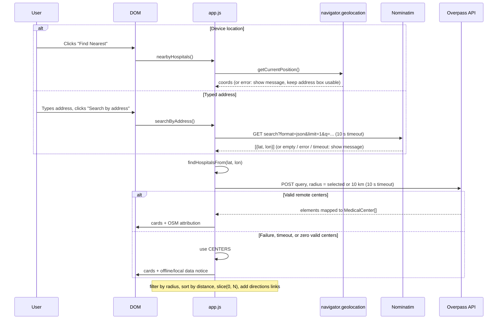
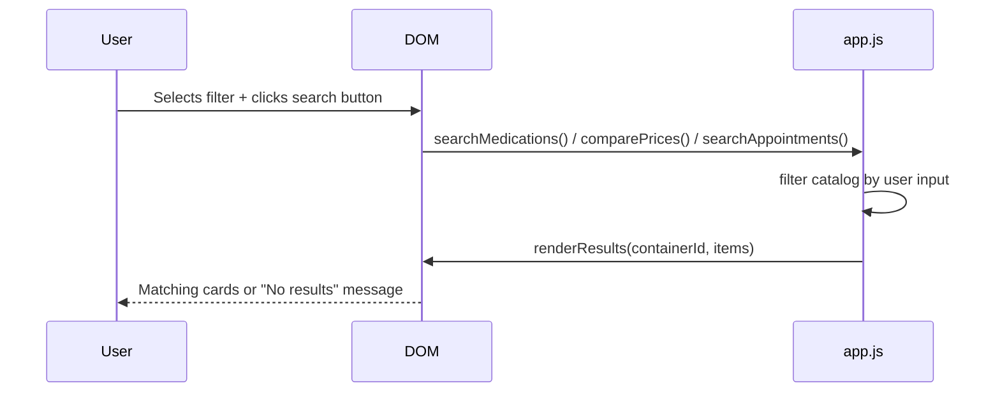

# Design Document: health-access-agent

## Overview

Health Access Agent is a zero-dependency, static single-page application that runs by opening `index.html` directly in a browser. It gives users immediate access to four health-service functions: finding nearby hospitals, checking medication stock and pricing, comparing service prices, and browsing appointment slots by specialty.

Medication, price, and appointment data live in in-memory JavaScript catalogs defined in `app.js` and stay fully offline. There is no backend, no build step, no npm runtime packages, no API keys, and no CDN. The application is composed of three files: `index.html` (structure), `styles.css` (presentation), and `app.js` (all logic and data).

The Nearby Hospitals module is the only module that uses the network. In response to a user action in the hospitals section only, it may call two OpenStreetMap endpoints: Nominatim (`https://nominatim.openstreetmap.org/search`) to geocode a typed address, and the Overpass API (`https://overpass-api.de/api/interpreter`) to fetch real nearby hospitals. The local `CENTERS` catalog is kept as the offline fallback. The browser-geolocation path and the typed-address path both converge on one shared function, `findHospitalsFrom(lat, lon)`. Results honour a user-selected count (3, 5, 10) and maximum radius (any, 5, 10, 25, 50 km), and each Card has a Google Maps directions link (plain navigation, no fetch).

The design prioritises simplicity and offline usability. Each module is self-contained and renders results into a dedicated DOM container using a shared generic rendering helper. A "No results" fallback is shown whenever a query returns an empty set.

---

## Architecture



---

## Sequence Diagrams

### Module 1: Nearby Hospitals



*(Superseded by the shared flow below; kept as the original baseline.)*

### Module 1 (extended): Shared Hospital Flow



### Module 2–4: Catalog Query (generic flow)



---

## Components and Interfaces

### Component 1: index.html

**Purpose**: Provides the page skeleton — four named sections, each with a control area (inputs/selects/buttons) and a results container.

**Responsibilities**:
- Define four `<section>` elements with IDs: `hospitals`, `medications`, `prices`, `appointments`.
- Each section has a results container: `#hospitals-results`, `#medications-results`, `#prices-results`, `#appointments-results`.
- Load `styles.css` and `app.js` with no module bundler.

**Section layout**:
| Section | Controls | Results container |
|---------|----------|-------------------|
| Nearby Hospitals | Button: "Find Nearest"; `#hospital-count-select` (3, 5, 10; default 3); `#hospital-radius-select` (any, 5, 10, 25, 50; default any); `#location-input` + "Search by address" button; privacy notice; OSM attribution element (shown only with remote data) | `#hospitals-results` |
| Medication Availability | Text input (med name) + Button | `#medications-results` |
| Price Comparator | Select (service type) + Button | `#prices-results` |
| Appointments | Select (specialty) + Button | `#appointments-results` |

---

### Component 2: styles.css

**Purpose**: Visual layout and responsive behaviour.

**Responsibilities**:
- Card grid: CSS Grid with `auto-fill`, `minmax(280px, 1fr)`.
- Uniform card appearance: border-radius, box-shadow, padding.
- Responsive breakpoints: single-column below 600 px.
- Status badge colours: green for "In stock" / "Available", red for "Out of stock" / "Full", orange for "Limited".
- No-results message style.

---

### Component 3: app.js

**Purpose**: All data catalogs, business logic, geolocation, distance calculation, and DOM rendering.

**Responsibilities**:
- Declare four in-memory data catalogs as `const` arrays.
- Expose four module functions called from inline `onclick` handlers.
- Implement `distanceKm` using the Haversine formula.
- Implement `renderResults` as a generic list-to-cards renderer.

---

## Data Models

### MedicalCenter

```javascript
{
  name: string,       // Display name, e.g. "Centro de Salud Norte"
  type: string,       // "Hospital" | "Clínica" | "Centro de Salud"
  address: string,    // Human-readable address
  phone: string,      // Contact number
  lat: number,        // Latitude  (decimal degrees)
  lon: number         // Longitude (decimal degrees)
}
```

**Validation rules**:
- `lat` must be in [-90, 90]; `lon` in [-180, 180].
- `name` must be non-empty.
- Catalog must contain ≥ 3 entries so the slice(0, 3) always has candidates.

---

### Medication

```javascript
{
  name: string,       // Generic or brand name, e.g. "Ibuprofeno 400mg"
  pharmacy: string,   // Pharmacy name
  status: string,     // "In stock" | "Out of stock" | "Limited"
  price: number       // Price in local currency (MXN)
}
```

---

### ServicePrice

```javascript
{
  service: string,    // e.g. "Consulta General", "Radiografía", "Análisis de Sangre"
  provider: string,   // Clinic or lab name
  price: number,      // Price in local currency
  includes: string    // Brief description of what is covered
}
```

---

### AppointmentSlot

```javascript
{
  specialty: string,  // e.g. "Cardiología", "Pediatría", "Dermatología"
  doctor: string,     // Doctor's name
  date: string,       // ISO date string "YYYY-MM-DD"
  time: string,       // "HH:MM"
  available: boolean  // true = slot open, false = taken
}
```

---

## Algorithmic Pseudocode

### Algorithm 1: distanceKm (Haversine)

```javascript
function distanceKm(lat1, lon1, lat2, lon2):
  INPUT:  lat1, lon1 — observer coordinates (decimal degrees)
          lat2, lon2 — target coordinates   (decimal degrees)
  OUTPUT: distance in kilometres (number ≥ 0)

  R = 6371                        // Earth's mean radius in km

  dLat = toRadians(lat2 - lat1)
  dLon = toRadians(lon2 - lon1)

  a = sin(dLat/2)² +
      cos(toRadians(lat1)) * cos(toRadians(lat2)) * sin(dLon/2)²

  c = 2 * atan2(sqrt(a), sqrt(1 - a))

  RETURN R * c
```

**Preconditions**:
- All four arguments are finite numbers.
- `lat1`, `lat2` ∈ [-90, 90]; `lon1`, `lon2` ∈ [-180, 180].

**Postconditions**:
- Result ≥ 0.
- `distanceKm(x, y, x, y) === 0` for any valid coordinates.
- Result is symmetric: `distanceKm(a, b, c, d) === distanceKm(c, d, a, b)`.

**Loop invariants**: N/A (no loops).

---

### Algorithm 2: nearbyHospitals

```javascript
function nearbyHospitals():
  INPUT:  none (reads navigator.geolocation, reads CENTERS catalog)
  OUTPUT: side effect — renders 3 closest centers into #hospitals-results

  getCurrentPosition(
    onSuccess: (position) => {
      coords = position.coords

      enriched = CENTERS.map(center => ({
        ...center,
        distance: distanceKm(coords.latitude, coords.longitude,
                              center.lat, center.lon)
      }))

      sorted   = enriched.sort((a, b) => a.distance - b.distance)
      top3     = sorted.slice(0, 3)

      items = top3.map(c => ({
        title:    c.name,
        subtitle: c.type + " — " + c.address,
        badge:    c.distance.toFixed(1) + " km",
        detail:   c.phone
      }))

      renderResults("hospitals-results", items)
    },
    onError: (err) => {
      renderResults("hospitals-results", [], "Geolocation denied or unavailable.")
    }
  )
```

**Preconditions**:
- `navigator.geolocation` is available in the browser.
- `CENTERS` has ≥ 1 entry (ideally ≥ 3).

**Postconditions**:
- DOM container `#hospitals-results` is updated.
- Shows at most 3 results sorted ascending by distance.
- On geolocation error, shows an informative message instead of crashing.

---

### Algorithm 2 (revised): nearbyHospitals, searchByAddress, and the shared flow

`nearbyHospitals()` is reduced to obtaining coordinates; the original "top 3 of CENTERS" logic moves into `findHospitalsFrom`. The pseudocode of Algorithm 2 above is superseded by the following.

#### Constants and option reading

```javascript
COUNT_OPTIONS  = [3, 5, 10]            // default 3
RADIUS_OPTIONS = ["any", 5, 10, 25, 50] // default "any"
DEFAULT_RADIUS_KM = 10                  // Overpass radius when "any" is selected
REQUEST_TIMEOUT_MS = 10000
MAX_QUERY_LENGTH = 200

function readCount():
  n = Number(#hospital-count-select.value)
  RETURN COUNT_OPTIONS.includes(n) ? n : 3

function readRadius():            // returns number of km, or null for "any"
  v = #hospital-radius-select.value
  IF v === "any" THEN RETURN null
  n = Number(v)
  RETURN [5,10,25,50].includes(n) ? n : null
```

#### nearbyHospitals

```javascript
function nearbyHospitals():
  show placeholder cards in #hospitals-results
  IF navigator.geolocation is missing THEN
    renderResults("hospitals-results", [], reasonMessage + " Type an address below instead.")
    RETURN
  getCurrentPosition(
    pos => findHospitalsFrom(pos.coords.latitude, pos.coords.longitude),
    err => renderResults("hospitals-results", [], failureReason(err) + " You can type an address below instead."),
    { timeout: 10000 })
```

#### geocodeAddress

```javascript
async function geocodeAddress(query):
  INPUT:  query — string
  OUTPUT: Promise<{ ok: true, lat, lon } | { ok: false, reason }>
          reason ∈ "empty" | "too-long" | "not-found" | "network" | "timeout"

  q = String(query).trim()
  IF q === "" THEN RETURN { ok: false, reason: "empty" }
  IF q.length > 200 THEN RETURN { ok: false, reason: "too-long" }

  controller = new AbortController()
  timer = setTimeout(() => controller.abort(), 10000)
  TRY
    res = await fetch("https://nominatim.openstreetmap.org/search?format=json&limit=1&q="
                      + encodeURIComponent(q), { signal: controller.signal })
    IF NOT res.ok THEN RETURN { ok: false, reason: "network" }
    data = await res.json()
    first = Array.isArray(data) ? data[0] : undefined
    lat = Number(first?.lat); lon = Number(first?.lon)
    IF first is undefined OR lat/lon not finite or out of range THEN RETURN { ok: false, reason: "not-found" }
    RETURN { ok: true, lat, lon }
  CATCH e
    RETURN { ok: false, reason: e.name === "AbortError" ? "timeout" : "network" }
  FINALLY
    clearTimeout(timer)
```

**Preconditions**: global `fetch` may or may not exist; absence is treated as `network`.
**Postconditions**: never throws; at most one request; no request when the reason is `empty` or `too-long`; on `ok: true`, `lat ∈ [-90, 90]` and `lon ∈ [-180, 180]`.

#### searchByAddress

```javascript
async function searchByAddress():
  show placeholder cards in #hospitals-results
  r = await geocodeAddress(#location-input.value)
  IF NOT r.ok THEN
    renderResults("hospitals-results", [], messageFor(r.reason))
    RETURN
  await findHospitalsFrom(r.lat, r.lon)
```

#### fetchRemoteCenters

```javascript
async function fetchRemoteCenters(lat, lon, radiusKm):
  INPUT:  lat, lon — finite coordinates; radiusKm — positive finite number
  OUTPUT: Promise<MedicalCenter[]>  // rejects on network error, non-OK status, or timeout

  r = Math.round(radiusKm * 1000)
  query = "[out:json][timeout:10];(" +
          'nwr["amenity"~"^(hospital|clinic|doctors)$"](around:' + r + ',' + lat + ',' + lon + ');' +
          ");out center;"

  controller = new AbortController()
  timer = setTimeout(() => controller.abort(), 10000)
  TRY
    res = await fetch("https://overpass-api.de/api/interpreter",
                      { method: "POST", body: "data=" + encodeURIComponent(query),
                        headers: {"Content-Type": "application/x-www-form-urlencoded"},
                        signal: controller.signal })
    IF NOT res.ok THEN THROW Error("overpass status")
    json = await res.json()
    RETURN mapOverpassElements(json?.elements)
  FINALLY
    clearTimeout(timer)
```

The query selects `nwr` restricted to `amenity` values `hospital|clinic|doctors`, which covers nodes and ways as required (relations carry a `center` as well and are mapped identically).

#### mapOverpassElements (pure)

```javascript
function mapOverpassElements(elements):
  IF NOT Array.isArray(elements) THEN RETURN []
  out = []
  FOR each el IN elements DO
    tags = el?.tags ?? {}
    name = typeof tags.name === "string" ? tags.name.trim() : ""
    IF name === "" THEN CONTINUE
    lat = Number(el.lat ?? el.center?.lat)
    lon = Number(el.lon ?? el.center?.lon)
    IF NOT (finite(lat) AND finite(lon) AND lat ∈ [-90,90] AND lon ∈ [-180,180]) THEN CONTINUE
    out.push({
      name,
      type: tags.amenity,
      address: join(non-empty [tags["addr:street"] + " " + tags["addr:housenumber"],
                               tags["addr:city"], tags["addr:postcode"]], ", "),
      phone: tags.phone || tags["contact:phone"] || "N/A",
      lat, lon })
  RETURN out
```

**Loop invariant**: `out` contains exactly the valid, named elements among those already processed, in input order.
**Postconditions**: every output has a non-empty `name`, finite in-range `lat`/`lon`, and a non-empty `phone`; `out.length ≤ elements.length`.

#### directionsUrl (pure)

```javascript
function directionsUrl(originLat, originLon, destLat, destLon):
  IF NOT (finite(destLat) AND finite(destLon)) THEN THROW Error("invalid destination")
  url = "https://www.google.com/maps/dir/?api=1"
  IF finite(originLat) AND finite(originLon) THEN
    url += "&origin=" + encodeURIComponent(originLat + "," + originLon)
  url += "&destination=" + encodeURIComponent(destLat + "," + destLon)
  RETURN url
```

Note: `encodeURIComponent` encodes the comma as `%2C`. Google Maps accepts both forms. Numeric coordinates are the only inputs, so no center name or address text can reach the URL.

#### findHospitalsFrom (shared flow)

```javascript
async function findHospitalsFrom(lat, lon):
  INPUT:  lat, lon — finite valid coordinates (from geolocation or geocoding)
  OUTPUT: side effect — renders into #hospitals-results and the attribution element

  count  = readCount()
  radius = readRadius()                       // number or null
  source = "remote"
  TRY
    centers = await fetchRemoteCenters(lat, lon, radius ?? DEFAULT_RADIUS_KM)
    IF centers.length === 0 THEN THROW Error("empty")
  CATCH
    centers = CENTERS
    source = "local"

  enriched = centers.map(c => ({ ...c, distance: distanceKm(lat, lon, c.lat, c.lon) }))
  IF radius !== null THEN enriched = enriched.filter(c => c.distance <= radius)
  sorted = enriched.sort((a, b) => a.distance - b.distance).slice(0, count)

  IF sorted is empty THEN
    msg = (centers is empty) ? "No medical centers are available."
        : "No hospitals found within " + radius + " km. Try increasing the radius."
    renderResults("hospitals-results", [], msg)   // plus notice/attribution as below
  ELSE
    items = sorted.map(c => ({ title: c.name, subtitle: c.type + " — " + c.address,
             badge: c.distance.toFixed(1) + " km", detail: c.phone,
             link: { href: directionsUrl(lat, lon, c.lat, c.lon), text: "How to get there" } }))
    renderResults("hospitals-results", items)

  IF source === "local" THEN show Fallback_Notice ("Showing offline/local data")
  ELSE show "Data © OpenStreetMap contributors" in the attribution element
```

**Preconditions**: `lat`, `lon` finite and in range.
**Postconditions**:
- Never throws; remote failures degrade to `CENTERS`.
- At most `count` Cards, sorted by ascending distance, each with a Directions_Link whose origin is `(lat, lon)`.
- When `radius !== null`, every rendered distance ≤ `radius`.
- Attribution is visible iff `source === "remote"`; Fallback_Notice is visible iff `source === "local"`.
- Exactly one Overpass request per invocation; no request to any other origin.

#### renderResults extension

`renderResults` accepts an optional `link: { href, text }` on each item. It renders `<a class="card-link" href="…" target="_blank" rel="noopener noreferrer">text</a>` with `href` and `text` HTML-attribute/text escaped. Items without `link` render as before, so Requirements 6.1 to 6.6 are unchanged.

---

### Algorithm 3: searchMedications

```javascript
function searchMedications():
  INPUT:  reads value of #medication-input (string)
  OUTPUT: side effect — renders matching entries into #medications-results

  query = document.getElementById("medication-input").value.trim().toLowerCase()

  IF query === "" THEN
    renderResults("medications-results", [], "Enter a medication name.")
    RETURN
  END IF

  matches = MEDICATIONS.filter(m =>
    m.name.toLowerCase().includes(query)
  )

  items = matches.map(m => ({
    title:    m.name,
    subtitle: m.pharmacy,
    badge:    m.status,
    detail:   "$" + m.price.toFixed(2)
  }))

  renderResults("medications-results", items)
```

**Preconditions**:
- DOM element `#medication-input` exists.
- `MEDICATIONS` is a non-empty array.

**Postconditions**:
- Shows all entries whose `name` contains the query (case-insensitive substring match).
- Shows "No results" card when no entries match.
- Empty query prompts the user without filtering.

---

### Algorithm 4: comparePrices

```javascript
function comparePrices():
  INPUT:  reads selected value of #service-select (string)
  OUTPUT: side effect — renders matching entries into #prices-results

  service = document.getElementById("service-select").value

  IF service === "" THEN
    renderResults("prices-results", [], "Select a service type.")
    RETURN
  END IF

  matches = PRICES.filter(p =>
    p.service === service
  )

  items = matches.map(p => ({
    title:    p.provider,
    subtitle: p.includes,
    badge:    "$" + p.price.toFixed(2),
    detail:   p.service
  }))

  renderResults("prices-results", items)
```

**Preconditions**:
- DOM element `#service-select` exists and contains options matching `PRICES[*].service` values.

**Postconditions**:
- Shows all providers offering the selected service type.
- Results are unsorted (catalog order); future iterations may sort by price.

---

### Algorithm 5: searchAppointments

```javascript
function searchAppointments():
  INPUT:  reads selected value of #specialty-select (string)
  OUTPUT: side effect — renders matching entries into #appointments-results

  specialty = document.getElementById("specialty-select").value

  IF specialty === "" THEN
    renderResults("appointments-results", [], "Select a specialty.")
    RETURN
  END IF

  matches = APPOINTMENTS.filter(a =>
    a.specialty === specialty && a.available === true
  )

  items = matches.map(a => ({
    title:    a.doctor,
    subtitle: a.specialty,
    badge:    a.available ? "Available" : "Full",
    detail:   a.date + " at " + a.time
  }))

  renderResults("appointments-results", items)
```

**Preconditions**:
- DOM element `#specialty-select` exists.
- `APPOINTMENTS` contains entries covering multiple specialties.

**Postconditions**:
- Shows only available slots (`available === true`) for the chosen specialty.
- Shows "No results" when all slots for the specialty are taken.

---

### Algorithm 6: renderResults (generic renderer)

```javascript
function renderResults(containerId, items, fallbackMessage = "No results found."):
  INPUT:  containerId    — string ID of the DOM container
          items          — array of { title, subtitle, badge, detail }
          fallbackMessage — optional string shown when items is empty
  OUTPUT: side effect — updates innerHTML of the container

  container = document.getElementById(containerId)

  IF items.length === 0 THEN
    container.innerHTML = '<p class="no-results">' + fallbackMessage + '</p>'
    RETURN
  END IF

  html = ""
  FOR each item IN items DO
    html += `
      <div class="card">
        <div class="card-header">
          <span class="card-title">${item.title}</span>
          <span class="card-badge">${item.badge}</span>
        </div>
        <p class="card-subtitle">${item.subtitle}</p>
        <p class="card-detail">${item.detail}</p>
      </div>
    `
  END FOR

  container.innerHTML = html
```

**Preconditions**:
- DOM element with `containerId` exists at call time.
- Each item in `items` has `title`, `subtitle`, `badge`, `detail` as strings.

**Postconditions**:
- Container's `innerHTML` is fully replaced.
- One `.card` element per item, or one `.no-results` paragraph when empty.

**Loop invariants**:
- `html` accumulates exactly one card fragment per processed item.
- Items already processed are correctly represented in `html` at the start of each iteration.

---

## Key Functions with Formal Specifications

| Function | Signature | Preconditions | Postconditions |
|----------|-----------|---------------|----------------|
| `distanceKm` | `(lat1, lon1, lat2, lon2) → number` | All args are finite numbers within valid coordinate ranges | Result ≥ 0; symmetric; zero when inputs identical |
| `nearbyHospitals` | `() → void` | Browser may or may not provide geolocation | Obtains coordinates and calls `findHospitalsFrom`; on failure shows a message with an address hint |
| `searchByAddress` | `() → Promise<void>` | `#location-input` exists | Geocodes, then calls `findHospitalsFrom`, or shows a clear message; never throws |
| `geocodeAddress` | `(query) → Promise<{ok, lat, lon} \| {ok:false, reason}>` | none | Never throws; no request for empty or over-200-char input; 10 s timeout |
| `fetchRemoteCenters` | `(lat, lon, radiusKm) → Promise<MedicalCenter[]>` | finite coords; radius > 0 | Resolves mapped centers; rejects on failure or timeout |
| `mapOverpassElements` | `(elements) → MedicalCenter[]` | none | Only named elements with finite in-range coordinates |
| `directionsUrl` | `(oLat, oLon, dLat, dLon) → string` | finite destination | Google Maps URL with encoded numeric coordinates only |
| `findHospitalsFrom` | `(lat, lon) → Promise<void>` | finite in-range coords | ≤ N cards sorted ascending, within radius if set, falls back to CENTERS, never throws |
| `searchMedications` | `() → void` | `#medication-input` exists; MEDICATIONS non-empty | DOM shows subset matching query; fallback on empty query or no match |
| `comparePrices` | `() → void` | `#service-select` exists; PRICES non-empty | DOM shows all providers for selected service |
| `searchAppointments` | `() → void` | `#specialty-select` exists; APPOINTMENTS non-empty | DOM shows only available slots for selected specialty |
| `renderResults` | `(containerId, items, fallbackMessage?) → void` | Container exists in DOM; items is an array | Container innerHTML replaced; no-results shown for empty array |

---

## Example Usage

```javascript
// 1. Geolocation + distance — triggered by button click
//    <button onclick="nearbyHospitals()">Find Nearest</button>
nearbyHospitals();
// → reads GPS, computes distances, renders top 3 cards

// 2. Medication search — triggered by button click
//    <input id="medication-input" /><button onclick="searchMedications()">Search</button>
document.getElementById("medication-input").value = "ibuprofeno";
searchMedications();
// → renders all medications whose name contains "ibuprofeno"

// 3. Price comparison — triggered by select + button
//    <select id="service-select">...</select><button onclick="comparePrices()">Compare</button>
document.getElementById("service-select").value = "Consulta General";
comparePrices();
// → renders all providers offering "Consulta General" with prices

// 4. Appointments — triggered by select + button
//    <select id="specialty-select">...</select><button onclick="searchAppointments()">Search</button>
document.getElementById("specialty-select").value = "Pediatría";
searchAppointments();
// → renders available appointment slots for Pediatría

// 5. Direct call to renderResults for custom messages
renderResults("hospitals-results", [], "Geolocation is not available in this browser.");
// → shows a "no-results" paragraph in the container
```

---

## Visual Design and Usability (Requirement 14)

This section adds a presentation layer on top of the existing behaviour. It changes `index.html`, `styles.css`, and small parts of `app.js` only. All existing element IDs, CSS classes, function names, and Renderer output stay as they are, so Requirements 1 to 13 and the existing tests are unaffected. The three-file delivery, no CDN, no external fonts or images, no framework, and the system font stack are kept. Icons are inline SVG or emoji.

### Design tokens (CSS custom properties on `:root`)

| Token group | Tokens | Notes |
|-------------|--------|-------|
| Colour | `--color-bg`, `--color-surface`, `--color-text`, `--color-muted`, `--color-primary`, `--color-primary-dark`, `--color-accent`, `--color-border` | Text on background and on surface at least 4.5:1; large text and UI borders at least 3:1 (WCAG AA) |
| Status | `--color-success`, `--color-warning`, `--color-danger`, `--color-neutral` and matching `-bg` tints | Badge colours keep the Requirement 8.3 mapping (green, orange, red, grey) |
| Shape | `--radius-sm`, `--radius-md`, `--radius-lg` | Rounded cards and controls |
| Elevation | `--shadow-sm`, `--shadow-md` | Soft shadows; `--shadow-md` on hover |
| Spacing | `--space-1` to `--space-6` | 4px scale |
| Type | `--font-sans: system-ui, -apple-system, "Segoe UI", Roboto, Helvetica, Arial, sans-serif` | No web fonts |
| Focus | `--focus-ring: 3px solid` a high-contrast colour, `outline-offset: 2px` | Applied with `:focus-visible` on links, buttons, inputs, selects |

### Layout

- Mobile-first: base styles target 320px; `@media (min-width: 600px)` and larger enlarge padding and put controls in a row.
- Hero (`<header class="hero">`): app name in `<h1>`, one-line tagline, and a decorative inline SVG or emoji. The sticky `<nav class="topnav">` follows it with `position: sticky; top: 0`.
- Each section is a panel (`<section class="panel">`) with a header row (icon, `<h2>`, one-line description `<p class="section-desc">`), a controls area, a results summary line, and the results container.
- The results grid keeps `repeat(auto-fill, minmax(280px, 1fr))` and collapses below 600px (Requirement 8). Container, cards, and controls use `min-width: 0`, `max-width: 100%`, and `overflow-wrap: anywhere` so nothing causes horizontal scroll at 320px.
- Buttons, selects, text inputs, nav links, and the card link have `min-height: 44px`.
- Footer (`<footer>`) with the disclaimer "Demo data. Not medical advice. In an emergency call your local emergency number." and an OpenStreetMap note. The existing `#osm-attribution` and `#privacy-notice` elements keep their IDs and positions in the hospitals panel.

### Markup and landmarks

```html
<a class="skip-link" href="#main">Skip to content</a>
<header class="hero">...</header>
<nav class="topnav" aria-label="Sections">...four links, each with an icon + text...</nav>
<main id="main">
  <section id="hospitals" class="panel" aria-labelledby="hospitals-title">...</section>
  ...
</main>
<footer>...</footer>
```

- `<html lang="en">` stays.
- Every input and select has a visible `<label for>`. Placeholders give examples, for example "Ibuprofeno" in `#medication-input` and "e.g. Av. Reforma 222, Mexico City" in `#location-input`.
- Results containers keep their IDs and gain `aria-live="polite"`. The summary line is a sibling element with `aria-live="polite"` and an ID of the form `<containerId>-summary`; Renderer output inside the container is unchanged.
- Primary actions use `class="btn btn-primary"`; secondary actions (for example "Search by address") use `class="btn btn-secondary"`.

### Components

| Component | Class or element | Behaviour |
|-----------|------------------|-----------|
| Card | `.card` with `.card-header`, `.card-title`, `.card-badge`, `.card-subtitle`, `.card-detail` | Title is bold; badge is a coloured pill; subtitle is muted; detail is prominent. For price and medication cards the price is the largest text in the detail line (`.card-detail` styled bold, larger size). Hover lifts the card with a stronger shadow. |
| Directions link | `.card-link` | Styled as a button (padding, background, 44px min height, hover and focus states) |
| Placeholder card | `.placeholder` | Skeleton blocks with a shimmer animation (`@keyframes shimmer`, gradient background-position); at least 3 shown while pending (Requirement 8.5) |
| Empty or info state | `.no-results` (and `.no-results.info`) | Icon plus message, neutral blue tint |
| Error state | `.no-results.error` | Icon plus message, red tint and a red left border; text colour keeps AA contrast on the tint |
| Summary line | `.results-summary` | One line above the results, for example "3 hospitals found" |
| Busy button | `button[aria-busy="true"]`, `button:disabled` | Dimmed, `cursor: not-allowed`, small CSS spinner via `::after` |

### Motion and contrast

- `@media (prefers-reduced-motion: reduce)` disables the shimmer, hover transforms, spinner rotation, and smooth scrolling (`animation: none; transition: none; scroll-behavior: auto`).
- Smooth scrolling is applied only under `@media (prefers-reduced-motion: no-preference)`.
- Colour is never the only carrier of meaning: badges carry text, error states carry an icon and text.

### app.js additions (small, behaviour-preserving)

```javascript
function setBusy(button, busy):
  IF button is null THEN RETURN
  button.disabled = busy
  IF busy THEN button.setAttribute("aria-busy", "true") ELSE button.removeAttribute("aria-busy")
  // optional: swap label via data-label / data-busy-label attributes

function renderSummary(containerId, text):
  el = document.getElementById(containerId + "-summary")
  IF el is null THEN RETURN          // never throws, never touches the results container
  el.textContent = text              // textContent, so no HTML injection

function initActiveNav():
  IF typeof IntersectionObserver is "undefined" THEN RETURN
  observer = new IntersectionObserver(entries => mark the link whose section is intersecting
             with class "active" and aria-current="true", clear the others,
             { rootMargin: "-40% 0px -50% 0px" })
  FOR each section IN [hospitals, medications, prices, appointments] DO observer.observe(section)
```

Integration rules:

- `searchByAddress()` and `nearbyHospitals()` call `setBusy` on their buttons before starting and in a `finally` block after the flow ends. Because a busy button is `disabled`, a second click cannot start a second request, so exactly one Nominatim and one Overpass request occur per user action.
- `#medication-input` handles `keydown` with `Enter` by calling `searchMedications()`. Selects do not trigger searches on `change`; only the button does.
- After rendering results, each module calls `renderSummary(...)` with a count text such as "3 hospitals found", "2 medications found", "4 providers found", "1 appointment found" (singular and plural handled), or an empty string when the result is an empty or error state.
- Empty and error states are produced by a small wrapper around `renderResults` that adds the icon and the `info` or `error` modifier class to the `.no-results` element. `renderResults` itself keeps its signature and its output for existing arguments (Requirement 6 unchanged); the optional `fallbackMessage` may be passed as an escaped string with a leading icon and modifier through an optional fourth parameter `{ kind: "info" | "error" }` that defaults to the current behaviour.
- `initActiveNav()` and the Enter handler are registered on `DOMContentLoaded` (or immediately if the document is already loaded), guarded so that loading `app.js` in tests still makes no network request.
- New functions are added to the guarded `module.exports`.

### Design decisions

- Keep `renderResults` as the single renderer and extend it only with an optional parameter, so Properties 13 and 14 and Requirement 6 stay true.
- Put summaries in a sibling element instead of the results container, so the "exactly M Cards" and "exactly one `.no-results`" contracts hold.
- Use `aria-live="polite"` on the containers so screen readers announce updates without interrupting.
- Disable the button instead of ignoring clicks in code, so the pending state is visible and enforced by the browser.

---

## Spanish Localization and Dynamic Appointment Dates (Requirements 15 and 16)

This section changes the user-visible language to Spanish and makes appointment dates relative to the current date. It touches `index.html` (copy) and `app.js` (strings, badge mapping, date helper, `APPOINTMENTS`). `styles.css` is not edited, and no element ID, class name, or function name changes.

### i18n approach

- Plain Spanish string literals written directly in `index.html` and `app.js`. No i18n library, no dictionary file, no language switcher, no extra file (the three-file delivery is kept).
- `<html lang="es">`; page title, hero, nav labels, section titles and descriptions, labels, placeholders, buttons, Privacy_Notice, Fallback_Notice, footer disclaimer, and the loading, prompt, error, and empty messages are all Spanish.
- Attribution wording becomes "Datos © colaboradores de OpenStreetMap", keeping the phrase "© colaboradores de OpenStreetMap".
- Summary lines use singular and plural forms: "1 hospital encontrado" and "N hospitales encontrados"; likewise "medicamento(s)", "precio(s)", and "cita(s)" with the matching participle "encontrado(s)" / "disponible(s)" as written in the copy. The plural choice is `n === 1 ? singular : plural`.
- Status values shown to users become "En stock", "Agotado", "Limitado", "Disponible", "Lleno". `MEDICATIONS[*].status` uses "En stock", "Agotado", "Limitado"; appointment cards use "Disponible" / "Lleno".
- Badge class mapping (`statusClass`-style lookup, case-insensitive) accepts both vocabularies:

| Colour | Spanish values | Previous English values |
|--------|----------------|-------------------------|
| green | En stock, Disponible | In stock, Available |
| red | Agotado, Lleno | Out of stock, Full |
| orange | Limitado | Limited |
| grey (neutral) | any other value | any other value |

- Catalog values: `PRICES[*].service` and `APPOINTMENTS[*].specialty` already hold Spanish names where applicable (for example "Consulta General", "Pediatría"). The `<option value>` strings in `#service-select` and `#specialty-select` must equal those catalog values exactly, so exact-match filtering (Requirements 4.1 and 5.1) keeps working. Any catalog field still in English (for example `includes` text) is translated at the same time in both the catalog and the options.
- Appointment card detail: `date + " a las " + time`, for example "2026-01-15 a las 09:30". Date stays ISO `YYYY-MM-DD` and time `HH:MM` (Requirement 5.4).
- Currency stays `"$" + price.toFixed(2)`.

### Dynamic appointment dates

```javascript
// Pure helper. baseDate: Date (local time). days: integer.
function addDaysISO(baseDate, days):
  d = new Date(baseDate.getFullYear(), baseDate.getMonth(), baseDate.getDate() + days)
  y = String(d.getFullYear()).padStart(4, "0")
  m = String(d.getMonth() + 1).padStart(2, "0")
  day = String(d.getDate()).padStart(2, "0")
  RETURN y + "-" + m + "-" + day
```

- Local-time components are used (not `toISOString`, which converts to UTC and can return the previous day). Building the date from year, month, and day-of-month avoids DST errors.
- At load, `APPOINTMENTS` is built with `const TODAY = new Date()` and each slot gets `date: addDaysISO(TODAY, offset)` with `offset` an integer in 1..30, spread across slots (for example 1, 2, 3, 5, 7, 9, 12, 15, 18, 21, 24, 28). The offset is never 0 or negative, so every date is strictly after today. No year literal appears in the catalog.
- The catalog keeps both `available: true` and `available: false` slots and at least two specialties. Times stay fixed `HH:MM` strings.
- `addDaysISO` is added to the guarded `module.exports`.

### Testing notes

- Existing tests that assert English strings (structure, medications, prices, appointments, hospitals, renderer, and any other that checks "No results found.", "In stock", "Available", "at", "hospitals found", or the English prompts and notices) are updated to the Spanish copy. Test expectations are not weakened.
- Tests that read `APPOINTMENTS` dates must not hardcode `2025`; they compare against the current local date.
- New tests cover `addDaysISO` (Property 29), dynamic `APPOINTMENTS` dates (Property 30), and the badge mapping for both vocabularies (Property 31).

## Mobile-App Look and Feel (Requirement 17)

This section restyles the app as a mobile health app: a welcome hero, an app-style home area with quick actions and a featured appointment, and a bottom tab bar on phones. It changes `index.html`, `styles.css`, and `app.js` only. No ID, class, handler, or module behaviour from Requirements 1 to 16 changes. There is no CDN, no external font or image, and no framework. Icons are inline SVG or emoji, and avatars are initial letters or emoji.

### Design system

The design tokens from Requirement 14 are updated in place on `:root`.

| Token group | Values |
|-------------|--------|
| Primary | `--color-primary: #1d4ed8` (white text on it is about 6.7:1), `--color-primary-dark: #1e3a8a`, `--color-primary-soft: #dbeafe` |
| Backgrounds | `--color-bg: #eff6ff` (light blue), `--color-surface: #ffffff`, `--hero-gradient: linear-gradient(180deg, #dbeafe 0%, #eff6ff 100%)` |
| Text | `--color-text: #0f172a`, `--color-muted: #475569` (at least 4.5:1 on white and on the light-blue background) |
| Tile accents | `--tile-hospital: #dc2626`, `--tile-meds: #059669`, `--tile-price: #d97706`, `--tile-appt: #7c3aed`; each is used for the icon on a 12% tint circle, and the label stays `--color-text` |
| Shape | `--radius-md: 16px`, `--radius-lg: 24px`, `--radius-pill: 999px` |
| Elevation | `--shadow-sm: 0 2px 8px rgba(15, 23, 42, .06)`, `--shadow-md: 0 8px 24px rgba(29, 78, 216, .15)` |
| Layout | `--container-max: 1100px`, `--tabbar-height: 64px` |
| Type | existing `--font-sans` system stack |

The existing status colours and badge mapping are unchanged.

### Layout and wireframe

Mobile (below 768px), top to bottom:

```
+-----------------------------------+
| Welcome_Hero (pale-blue gradient) |
|  Atención de calidad,             |
|  **donde estés** (bold blue)      |
|  subtitle                         |
|  [Feature_Strip: blue panel]      |
|   🏥 Hospitales | 💊 Medic. | 🩺 Citas |
|  ( Comenzar )  white pill         |
+-----------------------------------+
| #home                             |
|  App_Bar: ☰/brand        ⓘ        |
|  Hola                             |
|  ¿Cómo podemos ayudarte hoy?      |
|  [tile][tile][tile][tile] (2x2)   |
|  Próxima cita disponible  Ver todas|
|  [ blue card: avatar, doctor,     |
|    specialty, date a las time,    |
|    pill Disponible ]              |
+-----------------------------------+
| #hospitals panel (app-screen card)|
| #medications panel                |
| #prices panel                     |
| #appointments panel               |
| footer                            |
+-----------------------------------+
| Tab_Bar fixed:                    |
| Inicio Hospitales (Precios) Medic. Citas |
+-----------------------------------+
```

Desktop (768px and up): the Tab_Bar is hidden and the sticky top navigation from Requirement 14 is shown. Everything sits in a centred container of at most 1100px. Quick actions are one row of four columns, and sections are stacked. On mobile the tiles use a 2-column grid, and the Feature_Strip items stay in one row of three.

The tab order places "Precios" in the visual centre (Inicio, Hospitales, Precios, Medicamentos, Citas) as a floating circle raised about 20px above the bar.

### Markup

```html
<a class="skip-link" href="#main">Saltar al contenido</a>
<header class="welcome-hero" id="top">
  <h1>Atención de calidad, <strong class="hero-accent">donde estés</strong></h1>
  <p class="hero-subtitle">...</p>
  <ul class="feature-strip">  <!-- 3 li: icon + label -->
  <button type="button" class="btn-pill" id="start-btn">Comenzar</button>
</header>
<nav class="topnav" aria-label="Secciones">...</nav>   <!-- hidden below 768px -->
<main id="main">
  <div id="home" class="home-area">
    <div class="app-bar"><span class="brand">...</span><span class="app-bar-info" aria-hidden="true">ⓘ</span></div>
    <p class="greeting">Hola</p>
    <h2 class="home-heading">¿Cómo podemos ayudarte hoy?</h2>
    <div class="quick-actions"> <!-- 4 a.quick-tile href="#hospitals|#medications|#prices|#appointments" -->
    <div id="featured-appointment" class="featured-card" hidden>...</div>
  </div>
  <section id="hospitals" class="panel">...</section> ...
</main>
<footer>...</footer>
<nav class="tabbar" aria-label="Navegación principal"> <!-- a.tab for #home, #hospitals, #medications, #appointments + a.tab-fab for #prices -->
```

The Quick_Action_Tiles and tab links are plain anchors with `href="#id"`, so they work without JavaScript. `app.js` only adds smooth scrolling. The `#featured-appointment` container carries the `hidden` attribute until `app.js` fills it, so there is no empty card when scripts fail or no slot exists.

### Components

| Component | Notes |
|-----------|-------|
| Welcome_Hero | Gradient background, rounded bottom corners (24px), `.hero-accent` bold in `--color-primary` |
| Feature_Strip | Solid `--color-primary` rounded panel, white text, three flex items (icon above label) |
| `.btn-pill` | White background, primary text, pill radius, `min-height: 48px`, soft shadow |
| App_Bar | Flex row: brand left, info icon right; icon button area is at least 44px |
| Quick_Action_Tile | White, 20px radius, soft shadow, `min-height: 96px`, coloured icon circle on top, label below |
| Featured_Appointment | `--color-primary` background, white text, 24px radius, avatar circle with initials, doctor, specialty, `.featured-detail`, pill "Disponible"; header row with title and a "Ver todas" link (`href="#appointments"`, 44px target) |
| Card avatar | `.card-avatar`: 40px circle with `--color-primary-soft` background, emoji inside, leading the card header; `aria-hidden="true"` |
| Panels | `.panel` becomes an app-screen card: white, 24px radius, soft shadow, padding of 16px (24px from 600px) |
| Tab_Bar | `position: fixed; bottom: 0`, white, top shadow, `padding-bottom: env(safe-area-inset-bottom)`, five grid columns; each `.tab` is at least 44px by 44px with icon above a small label; `.tab.active` uses `--color-primary` text; `.tab-fab` is a 56px blue circle with white icon, `margin-top: -20px` |

### Responsive rules

- `@media (max-width: 767px)`: `.tabbar { display: grid }`, `.topnav { display: none }`, `main` and `footer` get `padding-bottom: calc(var(--tabbar-height) + env(safe-area-inset-bottom) + 16px)`, and `.quick-actions` uses 2 columns.
- `@media (min-width: 768px)`: `.tabbar { display: none }`, `.topnav { display: flex }`, `.quick-actions` uses 4 columns, and content is centred with `max-width: var(--container-max)`.
- `html` gets `scroll-padding-top` so anchored sections are not hidden under the sticky nav. Smooth scrolling is allowed only under `prefers-reduced-motion: no-preference`, and `.quick-tile`/`.card` hover transforms are removed under `reduce`.
- `index.html` keeps `<meta name="viewport" content="width=device-width, initial-scale=1, viewport-fit=cover">` so `env(safe-area-inset-bottom)` works on notched phones.

### app.js additions

```javascript
// Pure. Earliest available slot by date, then time. Dates are ISO YYYY-MM-DD and times are HH:MM,
// so string comparison orders them correctly.
function nextAvailableAppointment(slots):
  IF NOT Array.isArray(slots) THEN RETURN null
  best = null
  FOR each s IN slots DO
    IF s is an object AND s.available === true THEN
      IF best is null OR (s.date, s.time) < (best.date, best.time) THEN best = s
  RETURN best

// Pure. Uppercase initials of at most the first two words.
function initials(name):
  IF typeof name is not "string" THEN RETURN "?"
  words = name.trim().split(/\s+/).filter(nonEmpty)
  IF words is empty THEN RETURN "?"
  RETURN uppercase of first character of each of the first two words, joined   // Array.from keeps surrogate pairs whole

// DOM. Fills #featured-appointment, or hides it.
function renderFeaturedAppointment():
  el = document.getElementById("featured-appointment")
  IF el is null THEN RETURN
  slot = nextAvailableAppointment(APPOINTMENTS)   // wrapped in try/catch
  IF slot is null THEN el.hidden = true; el.innerHTML = ""; RETURN
  el.innerHTML = escaped markup: title, "Ver todas" link, avatar with initials(slot.doctor),
                 doctor, specialty, slot.date + " a las " + slot.time, pill "Disponible"
  el.hidden = false
```

- `renderFeaturedAppointment()` runs on `DOMContentLoaded`. It makes no network request.
- All inserted strings are HTML-escaped with the existing escape helper.
- `renderResults` gains an optional item field `icon`. When it is a non-empty string, the card header is prefixed with `<span class="card-avatar" aria-hidden="true">ICON</span>` (escaped). When absent or empty, the output is byte-identical to the current output, so Properties 13, 14, and 28 still hold. The four modules set `icon` to 🏥, 💊, 💲, and 🩺.
- **Active-nav observer reuse**: `initActiveNav()` observes the sections `home`, `hospitals`, `medications`, `prices`, `appointments`. Its link lookup selects every anchor in `.topnav` and `.tabbar` whose `href` equals `#<id>`, so one observer marks both bars. The `#home` observation marks the "Inicio" tab (and no top-nav link, because the top nav has none for home). The guard for a missing `IntersectionObserver` stays.
- **Smooth scrolling**: `initSmoothScroll()` registers click handlers on `#start-btn`, `.quick-tile`, `.tab`, `.tab-fab`, and the "Ver todas" link. Each calls `scrollIntoView({ behavior })`, where `behavior` is `"auto"` when `matchMedia("(prefers-reduced-motion: reduce)")` matches and `"smooth"` otherwise, and calls `preventDefault()` only when the target exists. Without JavaScript the anchors still jump. `#start-btn` scrolls to `#home`.
- New functions are added to the guarded `module.exports`: `nextAvailableAppointment`, `initials`, `renderFeaturedAppointment`, `initSmoothScroll`.

### Design decisions

- Anchors for tiles and tabs keep navigation working without JavaScript and reuse the section IDs.
- The Tab_Bar and the top navigation are separate elements shown by media query, so each keeps a simple structure and the 44px targets.
- The featured card uses only `APPOINTMENTS`, so no medical data is invented.
- `icon` is an optional field so the Renderer contract stays stable.
- ISO date and 24-hour time strings compare correctly as strings, so `nextAvailableAppointment` needs no date parsing.

---

## Correctness Properties

*A property is a characteristic or behavior that should hold true across all valid executions of a system — essentially, a formal statement about what the system should do. Properties serve as the bridge between human-readable specifications and machine-verifiable correctness guarantees.*

### Property 1: Distance non-negativity
*For any* two valid coordinate pairs within the ranges lat ∈ [-90, 90] and lon ∈ [-180, 180], `distanceKm` returns a value ≥ 0.

**Validates: Requirements 1.3**

### Property 2: Distance identity
*For any* valid coordinate point (lat, lon), `distanceKm(lat, lon, lat, lon)` returns exactly 0.

**Validates: Requirements 1.2**

### Property 3: Distance symmetry
*For any* two valid coordinate pairs (a, b) and (c, d), `distanceKm(a, b, c, d)` equals `distanceKm(c, d, a, b)`.

**Validates: Requirements 1.4**

### Property 4: Top-N bound and sort order
*For any* observer coordinates, any center list with at least one entry, and any selected Result_Count N in {3, 5, 10} (default 3), the Hospital_Flow renders at most N Cards, exactly min(N, available centers) when no radius filter applies, and the rendered entries are ordered by ascending distance from the observer.

**Validates: Requirements 2.2, 2.3, 10.3**

### Property 5: Hospital card completeness
*For any* set of medical centers rendered by `nearbyHospitals`, each Card contains the center's name, type and address, distance in km rounded to one decimal place, and phone number.

**Validates: Requirements 2.5**

### Property 6: Case-insensitive medication search
*For any* non-empty query string and any MEDICATIONS catalog, every Card rendered by `searchMedications` has a `name` field that contains the query as a case-insensitive substring.

**Validates: Requirements 3.1**

### Property 7: Whitespace query guard
*For any* string composed entirely of whitespace characters submitted to `searchMedications`, the function renders a prompt message and zero medication Cards.

**Validates: Requirements 3.2**

### Property 8: Medication card completeness
*For any* set of medications rendered by `searchMedications`, each Card contains the medication's name, pharmacy, availability status, and price formatted as a currency string.

**Validates: Requirements 3.4**

### Property 9: Price filter exactness
*For any* selected service string and any PRICES catalog, every Card rendered by `comparePrices` has a `service` field that exactly equals the selected service string.

**Validates: Requirements 4.1**

### Property 10: Price card completeness
*For any* set of service prices rendered by `comparePrices`, each Card contains the provider name, service description, what is included, and price formatted as a currency string.

**Validates: Requirements 4.4**

### Property 11: Available-only appointment filter
*For any* APPOINTMENTS catalog and any selected specialty, `searchAppointments` never renders a Card for a slot where `available` is `false`.

**Validates: Requirements 5.1, 5.5**

### Property 12: Appointment card completeness
*For any* set of appointment slots rendered by `searchAppointments`, each Card contains the doctor's name, specialty, date in ISO format, and scheduled time.

**Validates: Requirements 5.4**

### Property 13: Renderer card count
*For any* array of N items (N ≥ 1) passed to `renderResults`, the target container holds exactly N `.card` elements after the call.

**Validates: Requirements 6.1**

### Property 14: Renderer idempotence
*For any* (containerId, items) pair, calling `renderResults` twice with the same arguments produces identical DOM output on both calls.

**Validates: Requirements 6.3**

### Property 15: Radius filter
*For any* observer coordinates, any center list, and any selected Search_Radius R in {5, 10, 25, 50}, every Card rendered by the Hospital_Flow shows a distance less than or equal to R, and no center whose true distance is at most R and that ranks within the top N is omitted.

**Validates: Requirements 10.4**

### Property 16: Invalid option values fall back to defaults
*For any* string read from `#hospital-count-select` that is not "3", "5", or "10", `readCount` returns 3, and *for any* string read from `#hospital-radius-select` that is not one of "any", "5", "10", "25", "50", `readRadius` returns null (any).

**Validates: Requirements 10.1, 10.2, 10.6**

### Property 17: Directions URL well-formedness and encoding
*For any* finite origin and destination coordinates, `directionsUrl` returns a string that parses as a URL with origin `https://www.google.com`, path `/maps/dir/`, `api=1`, a `destination` parameter that decodes to `destLat,destLon`, and an `origin` parameter that decodes to `originLat,originLon`. *For any* call with a non-finite origin, the URL has no `origin` parameter. The URL contains only characters from the coordinate numbers and the fixed template, so no name or address text can appear in it.

**Validates: Requirements 11.2, 11.3, 11.4, 11.7**

### Property 18: Every hospital Card has a safe directions link
*For any* set of centers rendered by the Hospital_Flow, every Card contains exactly one anchor whose `href` equals `directionsUrl(originLat, originLon, center.lat, center.lon)`, with `target="_blank"` and `rel` containing both `noopener` and `noreferrer`, and the render performs zero `fetch` calls for the links.

**Validates: Requirements 11.1, 11.5, 11.6**

### Property 19: Overpass mapping drops unnamed elements and never yields invalid coordinates
*For any* array of arbitrary OSM_Elements (nodes with `lat`/`lon`, ways with `center`, missing or blank names, missing or non-numeric coordinates, missing tags), `mapOverpassElements` returns only objects with a non-empty `name`, finite `lat` in [-90, 90] and finite `lon` in [-180, 180], and a non-empty `phone` (equal to the `phone` tag, else the `contact:phone` tag, else "N/A"). The output length is at most the input length, and its names are exactly those of the input elements that are named and have valid coordinates, in input order. For ways, `lat` and `lon` come from `center`.

**Validates: Requirements 13.2, 13.3, 13.4**

### Property 20: Remote failure falls back to CENTERS
*For any* observer coordinates, selected count, and selected radius, and for any Overpass outcome among network rejection, non-OK status, abort timeout, malformed JSON, and a response yielding zero valid centers, the Hospital_Flow does not throw, renders results computed from CENTERS using the same count, radius, and sort rules, and shows the Fallback_Notice.

**Validates: Requirements 13.5, 13.6, 13.7, 13.9**

### Property 21: Attribution and fallback notice are mutually exclusive
*For any* Hospital_Flow run, the Attribution_Text is visible if and only if the rendered data came from a successful, non-empty Overpass response, and the Fallback_Notice is visible if and only if the data came from CENTERS.

**Validates: Requirements 13.5, 13.8**

### Property 22: Geocoder input guard
*For any* string that is empty or whitespace-only, or whose trimmed length exceeds 200 characters, `geocodeAddress` resolves with a failure reason (`empty` or `too-long`) and performs zero `fetch` calls.

**Validates: Requirements 12.4, 12.5**

### Property 23: Geocoder request encoding
*For any* trimmed query of 1 to 200 characters (including `&`, `#`, `?`, `%`, spaces, and non-ASCII characters), the single `fetch` URL equals `https://nominatim.openstreetmap.org/search?format=json&limit=1&q=` followed by `encodeURIComponent(query)`, and the `q` parameter decodes back to the trimmed query.

**Validates: Requirements 12.2**

### Property 24: Geocoder never throws and classifies outcomes
*For any* mocked `fetch` outcome (resolved array with a valid first result, empty array, non-array JSON, non-finite or out-of-range coordinates, non-OK status, rejection, abort), `geocodeAddress` resolves without throwing. It returns `ok: true` with finite in-range coordinates only for a valid first result, `not-found` for an empty or invalid result, `timeout` for an abort, and `network` otherwise.

**Validates: Requirements 12.3, 12.6, 12.7, 12.8**

### Property 25: Remote data is HTML-escaped
*For any* Remote_Data center whose `name`, `type`, `address`, or `phone` contains HTML metacharacters (`<`, `>`, `&`, `"`, `'`), the rendered hospital Card contains the literal text of each field and creates no additional elements from the field content.

**Validates: Requirements 13.12**

---

### Property 26: Summary line reflects the rendered count

*For any* non-negative integer N and module label, `renderSummary` sets the summary element's text to a string containing N when N ≥ 1 and to an empty string for the empty or error state, using `textContent` so no markup in the text becomes DOM nodes. Calling it for a missing summary element does not throw and does not modify the results container.

**Validates: Requirements 14.10, 14.11**

### Property 27: Busy state prevents double submission

*For any* button, `setBusy(button, true)` yields `disabled === true` and `aria-busy="true"`, and `setBusy(button, false)` restores `disabled === false` with no `aria-busy` attribute. *For any* number of activations of the hospital search while the button is busy, at most one geocoding request and one Overpass request are issued.

**Validates: Requirements 14.8, 14.9**

### Property 28: Renderer contract is preserved by the visual redesign

*For any* array of items (including the empty array) and any optional `kind`, `renderResults` still produces exactly one `.card` per item with `.card-title`, `.card-badge`, `.card-subtitle`, `.card-detail`, and `.card-link` where a link is supplied, or exactly one `.no-results` element for the empty array, and identical output for identical arguments.

**Validates: Requirements 14.12, 14.13, 6.1, 6.2, 6.3**

### Property 29: addDaysISO yields a valid later ISO date

*For any* valid base date and any integer offset N ≥ 1, `addDaysISO(base, N)` returns a string matching `YYYY-MM-DD` that denotes a real calendar date strictly after the base date's local ISO date, and the difference between the two dates is exactly N calendar days.

**Validates: Requirements 16.2, 16.3**

### Property 30: Every appointment date is after today

*For any* current local date at load time, every `APPOINTMENTS` entry has a `date` in `YYYY-MM-DD` format that is strictly greater than today's local ISO date, and no date is hardcoded to a past year.

**Validates: Requirements 16.1, 16.4**

### Property 31: Badge colour mapping covers both vocabularies

*For any* status string, the badge class is green for "En stock", "Disponible", "In stock", "Available", red for "Agotado", "Lleno", "Out of stock", "Full", orange for "Limitado" and "Limited", and neutral grey for every other string, without throwing.

**Validates: Requirements 15.7, 15.8**

### Property 32: nextAvailableAppointment returns the earliest available slot

*For any* array of appointment slots, `nextAvailableAppointment` returns `null` when no slot has `available === true`, and otherwise returns an available slot such that no other available slot has an earlier `date`, or the same `date` with an earlier `time`; the result is a member of the input array.

**Validates: Requirements 17.11, 17.13, 17.14**

### Property 33: initials is a non-empty uppercase string

*For any* string that contains at least one non-whitespace character, `initials` returns a non-empty string of at most two characters that equals its own uppercase form, and *for any* blank or non-string value it returns "?".

**Validates: Requirements 17.12, 17.13**

### Property 34: Renderer output is unchanged when no icon is given, and shows the icon when given

*For any* array of items without an `icon` field, `renderResults` produces the same output as before Requirement 17, and *for any* item with a non-empty `icon` string, the Card contains exactly one `.card-avatar` whose text equals the icon, with HTML in the icon escaped.

**Validates: Requirements 17.18, 17.19, 17.27**

## Error Handling

### Scenario 1: Geolocation denied or unavailable

**Condition**: User denies permission or browser does not support `navigator.geolocation`.  
**Response**: The `onError` callback of `getCurrentPosition` fires.  
**Recovery**: Call `renderResults("hospitals-results", [], "Geolocation denied or unavailable.")` — the section shows a friendly message, no crash.

### Scenario 2: No medications match the search query

**Condition**: `MEDICATIONS.filter()` returns an empty array.  
**Response**: `renderResults` receives `items = []`.  
**Recovery**: The container shows "No results found." — no blank section.

### Scenario 3: Empty select / no option chosen

**Condition**: User clicks search without selecting a service or specialty.  
**Response**: Guard clause at the top of each function detects `value === ""`.  
**Recovery**: Renders a prompt message such as "Select a service type." — prevents full-catalog dump.

### Scenario 5: Manual address problems

| Condition | Response in `#hospitals-results` | Request sent |
|-----------|----------------------------------|--------------|
| Empty or whitespace query | Prompt to type an address or city | No |
| Query over 200 characters | "Query too long" message | No |
| Nominatim returns `[]` or invalid coordinates | "Address not found" message | Yes |
| Network error or non-OK status | "Could not look up the address" message | Yes |
| No response within 10 s (AbortController) | Timeout message | Yes, aborted |

`geocodeAddress` always resolves; it never throws, so `searchByAddress` needs no outer try/catch beyond a defensive one.

### Scenario 6: Overpass failure

**Condition**: network error, non-OK status, 10 s timeout, malformed JSON, or zero valid mapped centers.
**Response**: `findHospitalsFrom` catches the error and uses `CENTERS`.
**Recovery**: Cards from `CENTERS` are shown with the notice "Showing offline/local data." The OSM attribution is hidden. The same count, radius, and sort rules apply.

### Scenario 7: No hospitals within the radius

**Condition**: a radius is selected and no center has `distance <= radius`.
**Response**: message "No hospitals found within R km. Try increasing the radius."
**Recovery**: the user picks a larger radius and searches again.

### Scenario 8: Geolocation fails

**Condition**: denied, timeout, or unavailable.
**Response**: the message from Scenario 1 is extended with a hint to type an address; `#location-input` and its button stay enabled. On `file://` the existing local-HTTP-server message is retained.

### Scenario 4: Browser blocks file:// geolocation (Chromium security policy)

**Condition**: Some Chromium-based browsers block geolocation on `file://` URLs.  
**Response**: `getCurrentPosition` triggers the error callback.  
**Recovery**: Same as Scenario 1. README instructs users to serve via a local server (`python -m http.server`) if they encounter this.

---

## Testing Strategy

### Unit Testing Approach

Each pure function (`distanceKm`, `renderResults`) can be tested in isolation by importing `app.js` into a test harness (e.g., Vitest with jsdom) and asserting return values or DOM mutations.

Key unit test cases:
- `distanceKm(0,0,0,0)` returns `0`.
- `distanceKm(19.4326, -99.1332, 19.4260, -99.1270)` returns a value close to known distance (~0.9 km).
- `renderResults("x", [])` sets the container to a `.no-results` paragraph.
- `renderResults("x", [{title:"T", subtitle:"S", badge:"B", detail:"D"}])` produces one `.card`.

### Property-Based Testing Approach

**Property Test Library**: fast-check

Properties to verify automatically:
- `distanceKm` returns `≥ 0` for all coordinate pairs sampled from valid ranges.
- `distanceKm` is symmetric for all sampled coordinate pairs.
- `renderResults` with an array of N items produces exactly N `.card` elements.
- `searchMedications` never renders more cards than `MEDICATIONS.length`.
- `searchAppointments` never renders a card for a slot where `available === false`.

### Testing the Hospital Enhancements

- **Network is always mocked.** Tests replace `globalThis.fetch` with `vi.fn()`; no test contacts OpenStreetMap. Mocks cover success, empty response, non-OK status, rejection, malformed JSON, and a never-resolving promise that honours `signal` (use `vi.useFakeTimers()` and advance 10 000 ms to trigger the abort).
- **Library**: Vitest with jsdom and fast-check, minimum 100 iterations per property test. Each property test is tagged `Feature: health-access-agent, Property N: <title>`.
- **Pure functions** (`directionsUrl`, `mapOverpassElements`, `readCount`, `readRadius`) are tested directly with generated inputs (Properties 16, 17, 19).
- **Async functions** (`geocodeAddress`, `fetchRemoteCenters`, `findHospitalsFrom`) are tested with mocked `fetch` and a jsdom DOM containing the hospital controls (Properties 4, 15, 18, 20 to 25).
- **Unit examples**: Nominatim request URL for "Mexico City"; Overpass request goes to `https://overpass-api.de/api/interpreter` with `around:10000` for the default radius and `around:5000` for a 5 km radius; the empty-radius message contains "radius"; the privacy notice and `#location-input` exist in `index.html`; no `fetch` call occurs when the medication, price, or appointment functions run; no `fetch` call occurs on page load.
- **Existing tests** in `tests/hospitals.test.js` must keep passing; tests that relied on `CENTERS` being used directly should mock `fetch` to reject so the fallback path exercises the same behaviour.

### Integration Testing Approach

Manual smoke test by opening `index.html` in a browser:
1. Click "Find Nearest" — should request location and render ≤ N hospital cards (default 3), each with a "How to get there" link.
   - Type an address and click "Search by address" — should render cards, or a clear message for empty, unknown, or failing input.
   - Go offline and search again — should show local data with the offline notice.
2. Type a medication name and click Search — should show matching cards.
3. Select a service from the dropdown and click Compare — should show price cards.
4. Select a specialty and click Search — should show available appointment cards.
5. Submit each module with no input — should show prompt messages, not errors.

---

### Testing the Visual Design and Usability Changes

- Structure tests in `tests/structure.test.js` load `index.html` in jsdom and assert landmarks (`header`, `nav`, `main`, `footer`), the skip link, `lang`, the four nav links with icons, visible `<label for>` associations for every input and select, `aria-live="polite"` on the four results containers, the footer disclaimer, and that all preserved IDs and classes still exist.
- `styles.css` is read as text and checked for the custom properties, `:focus-visible`, `prefers-reduced-motion`, `min-height: 44px`, `@keyframes shimmer`, and the `minmax(280px, 1fr)` grid. Real contrast and 320px layout are checked manually, because jsdom does not compute layout.
- Example-based tests cover `setBusy`, `renderSummary`, the Enter key on `#medication-input`, and `initActiveNav` with and without `IntersectionObserver`. Properties 26 to 28 are optional property tests; the existing renderer tests keep covering Properties 13 and 14.
- UI rendering is not a good fit for property-based testing, so Properties 26 to 28 apply only to the pure helpers.

### Testing Spanish Localization and Dynamic Dates

- `tests/structure.test.js` asserts `<html lang="es">`, the Spanish title, hero, nav labels, labels, placeholders, footer disclaimer, and Privacy_Notice, plus the preserved IDs and classes.
- Module tests (medications, prices, appointments, hospitals, renderer) assert the Spanish prompts, errors, "No se encontraron resultados." style empty messages, singular and plural summaries ("1 hospital encontrado", "3 hospitales encontrados"), the Spanish status values, and the "a las" appointment detail.
- The badge mapping is tested for the Spanish and the English values and for unknown values (Property 31).
- `addDaysISO` is tested with fast-check (Property 29, minimum 100 iterations) with month-end, year-end, and leap-day examples. A catalog test checks Property 30 against the current local date, that offsets are in 1..30 (derived from the dates), and that available and unavailable slots and at least two specialties remain.
- Tests tagged `Feature: health-access-agent, Property N: <title>`.

### Testing the Mobile-App Look and Feel

- Property-based tests (fast-check, at least 100 iterations, tagged `Feature: health-access-agent, Property N: <title>`) cover the pure helpers `nextAvailableAppointment` (Property 32) and `initials` (Property 33), and the Renderer with and without `icon` (Property 34).
- `tests/structure.test.js` loads `index.html` in jsdom and asserts: the Welcome_Hero tagline with `.hero-accent` "donde estés", the subtitle, a Feature_Strip with three items, the "Comenzar" button, the App_Bar, "Hola", the heading "¿Cómo podemos ayudarte hoy?", four Quick_Action_Tiles with the right labels and `href` values, the `#featured-appointment` container, the Tab_Bar nav with four tabs plus the "Precios" floating link, the viewport meta with `viewport-fit=cover`, and that all preserved IDs and classes still exist.
- `styles.css` is read as text and checked for the royal-blue token, `--radius-lg`, the `767px` and `768px` media queries, `.tabbar` fixed positioning, `env(safe-area-inset-bottom)`, `max-width` 1100px, and `min-height: 44px` on tabs and tiles. Real layout and contrast are checked manually, because jsdom does not compute layout.
- Example tests cover `renderFeaturedAppointment` (card shown with doctor, initials, "a las", and "Disponible" for the earliest slot; card hidden when `APPOINTMENTS` has no available slot), `initActiveNav` marking both a top-nav link and a tab, `initSmoothScroll` calling `scrollIntoView` for "Comenzar" and tiles, and the hospital, medication, price, and appointment cards carrying the expected icons.
- UI rendering is not a good fit for property-based testing, so the properties above apply only to the pure helpers and the Renderer.

## Performance Considerations

- All catalogs are small static arrays (< 50 entries each). Filter and sort operations are O(n) and imperceptible.
- `distanceKm` is called once per catalog entry on each geolocation query — O(n) with minimal floating-point overhead.
- DOM writes use a single `innerHTML` assignment per render call, avoiding repeated reflows.
- Catalog queries for medications, prices, and appointments make no network requests and have zero latency.
- A hospital search makes at most one Nominatim request (address path) and one Overpass request, each bounded by a 10 s timeout. Placeholder Cards are shown while they are pending.
- Overpass queries are scoped by `around:` and a 10 km default radius to keep responses small.

---

## Security Considerations

- **Limited, user-initiated data sharing.** Network requests go only to `https://nominatim.openstreetmap.org` and `https://overpass-api.de`, and only after the user clicks "Find Nearest" or "Search by address". Nominatim receives the typed address; Overpass receives the coordinates and radius. Medication, price, and appointment modules send nothing. A short privacy notice near the two hospital buttons tells the user that coordinates or the typed address are sent to OpenStreetMap services. No cookies, API keys, or identifiers are sent.
- **XSS**: Remote data (names, types, addresses, phones from OpenStreetMap) is untrusted. `renderResults` MUST HTML-escape every field, including link text, and escape the `href` attribute value. Typed user input is never interpolated into HTML; it is only passed through `encodeURIComponent` into the Nominatim URL.
- **Directions URL**: built only from numeric coordinates run through `encodeURIComponent`, never from names or addresses, and the anchor uses `target="_blank"` with `rel="noopener noreferrer"`. It is a navigation link; the app does not fetch it.
- **Response validation**: coordinates from Nominatim and Overpass are coerced with `Number` and rejected unless finite and in range, so a malformed response cannot produce `NaN` distances.
- **Attribution**: when remote data is shown, "Data © OpenStreetMap contributors" is displayed to meet the OSM licence.
- **No `eval` or dynamic script loading.** All logic is in a single static `app.js` file.
- **CSP-friendly**: The app requires no inline event attribute exceptions beyond what standard HTML `onclick` attributes need; a permissive default-src 'self' policy is sufficient.

---

## Dependencies

| Dependency | Type | Purpose |
|------------|------|---------|
| `navigator.geolocation` | Browser built-in API | Obtain device GPS coordinates |
| `fetch`, `AbortController` | Browser built-in APIs | Call the two OpenStreetMap endpoints with a 10 s timeout |
| Nominatim (`https://nominatim.openstreetmap.org/search`) | Public web service, no API key | Geocode a typed address (user action only) |
| Overpass API (`https://overpass-api.de/api/interpreter`) | Public web service, no API key | Fetch real nearby hospitals (user action only) |
| Google Maps directions URL | Plain link, opened in a new tab | "How to get there"; never fetched by the app |
| None (pure JS) | — | All logic is vanilla JavaScript |
| None | — | No npm runtime packages, no API keys, no CDN imports; still delivered as three files |

Dev-only test tooling (Vitest, jsdom, fast-check) is not part of the delivered files.

**Runtime requirements**: Any modern browser (Chrome 60+, Firefox 55+, Safari 11+, Edge 79+) with JavaScript enabled.
